# DispatchIQ: Resource Allocation Engine

> **Who does which job?** A field-service company in Bengaluru has technicians with different skills and shifts,
> and a stream of repair requests through the day. This project assigns technicians to jobs in two very different
> ways and compares them side by side:
>
> 1. **Hungarian (batch):** a classic optimiser that sees the *whole day* and plans everything at once.
> 2. **ML Dispatcher (online):** a machine-learning model that decides *each request as it arrives*. It learned its
>    behaviour by imitating the optimiser.

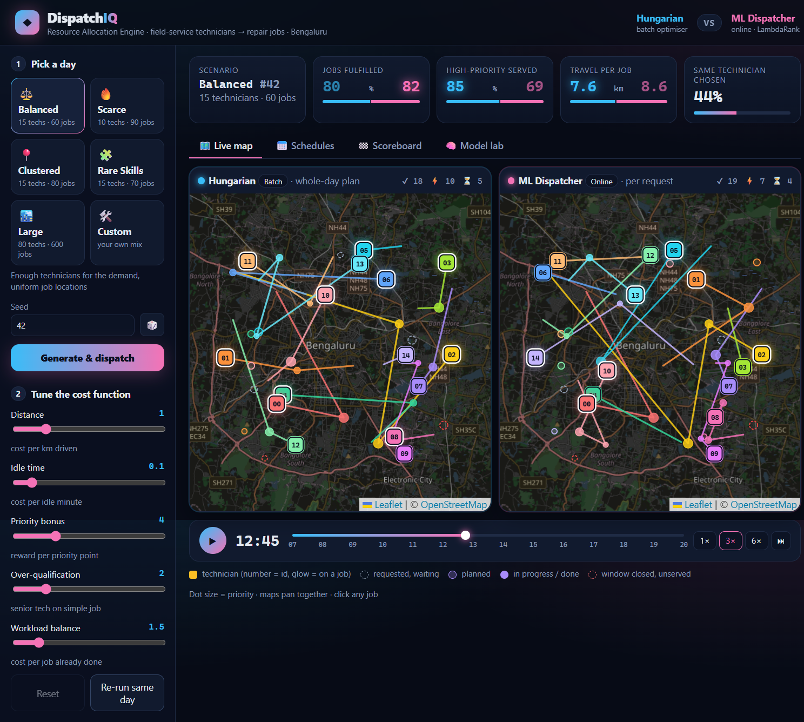

| | |
|---|---|
| **Stack** | FastAPI · NumPy / SciPy · scikit-learn · LightGBM · React + TypeScript · Leaflet (OpenStreetMap) · Recharts |
| **Runs** | Fully local. No API keys, no paid services. |
| **Tests** | 33 pytest tests, plus an executed exploration notebook |

---

## Contents

1. [Quick start](#1-quick-start)
2. [Tour of the UI](#2-tour-of-the-ui)
3. [Architecture: six views](#3-architecture-six-views)
4. [Data planning](#4-data-planning)
5. [Constraints](#5-constraints)
6. [The two algorithms](#6-the-two-algorithms)
7. [ML planning](#7-ml-planning)
8. [Testing](#8-testing)
9. [Results in one page](#9-results-in-one-page)
10. [Decision log](#10-decision-log)
11. [Limitations and next steps](#11-limitations-and-next-steps)
12. [Project layout and API](#12-project-layout-and-api)

---

## 1. Quick start

Requirements: **Python 3.11+** and **Node 18+**. Run the backend and the frontend in two separate terminals.

**Terminal 1: backend (Windows PowerShell)**

```powershell
cd backend
python -m venv .venv
.\.venv\Scripts\python.exe -m pip install -r requirements.txt
.\.venv\Scripts\python.exe -m uvicorn app.main:app --port 8000
```

**Terminal 1: backend (macOS / Linux)**

```bash
cd backend
python3 -m venv .venv
.venv/bin/python -m pip install -r requirements.txt
.venv/bin/python -m uvicorn app.main:app --port 8000
```

The API runs at http://127.0.0.1:8000. Check http://127.0.0.1:8000/api/health, or open the interactive docs at
`/docs`.

**Terminal 2: frontend**

```bash
cd frontend
npm install
npm run dev
```

Open **http://localhost:5173**. The first day loads automatically. Vite forwards `/api` calls to port 8000, so the
backend must be running first.

**Notes:**
- A trained model is included at `backend/models/scorer.joblib`. If it's missing, or can't be loaded with your
  installed library versions, the API trains a quick replacement on the first ML request. This takes about 15 s,
  once.
- The commands call the venv's Python directly, so you don't need to *activate* the venv. That avoids PowerShell's
  script execution policy. If you prefer activating, `.\.venv\Scripts\activate` also works.
- The repository root also has a `requirements.txt` that points to `backend/requirements.txt`.

| Task | Command (from `backend/`, using the venv's Python) |
|---|---|
| Run tests | `python -m pytest` |
| Retrain the model (~30 s) | `python -m app.ml.train` |
| Benchmark both algorithms | `python benchmark.py --seeds 5` → `results/benchmark.json` |
| Open the exploration notebook | `pip install -r requirements-dev.txt`<br>`python -m ipykernel install --user --name allocation-venv`<br>then open `notebooks/01_model_exploration.ipynb` |

**Troubleshooting**

| Symptom | Fix |
|---|---|
| UI shows `⚠ 500` or stays on "Dispatching…" | The backend isn't running, or is still starting. Check http://127.0.0.1:8000/api/health. |
| `Port 5173 is in use` | Another Vite server is already running. Stop it, or use the port Vite prints. |
| `Address already in use` on 8000 | Stop the other process, or start with `--port 8001` and change the proxy target in `frontend/vite.config.ts`. |
| PowerShell refuses `activate` | Use the direct `.venv\Scripts\python.exe` commands shown above. |

---

## 2. Tour of the UI

The left rail has two steps:
1. **Pick a day:** a preset card plus a seed (🎲 picks a random seed).
2. **Tune the cost function:** five sliders, then *Re-run same day*.

The KPI strip at the top shows each metric as a *duel*, Hungarian in blue vs ML in pink. The brighter number wins.

| Tab | What you see | Why it's useful |
|---|---|---|
| 🗺️ **Live map** | Two synced maps, one per algorithm, and a **day-playback timeline** (▶, 1× / 3× / 6×). Technicians drive along their routes; jobs appear when requested, glow while in progress and fill in when done. Dashed red rings are jobs whose window closed unserved. | Shows *how* each plan unfolds over the day, not just the totals |
| 📅 **Schedules** | A Gantt chart: every technician has **two lanes** (Hungarian above, ML below). Striped = driving, dotted = idle, solid = on the job (colour = priority). | Shows idle gaps and workload. Hungarian's round-based waiting is easy to spot. |
| 🏁 **Scoreboard** | A radar chart of plan shape, head-to-head bars for 9 metrics, metrics won, and an auto-generated verdict | The comparison at a glance |
| 🧠 **Model lab** | The training pipeline, model selection results, feature importance and held-out outcomes (read from the model card) | Shows how the ML model was built and validated |

**Job inspector.** Click any job on a map or in the Gantt chart. A drawer opens with both algorithms' decisions side
by side:
- **Hungarian:** which round it was assigned in, the chosen technician's rank by its own cost, and cheaper
  alternatives.
- **ML:** SHAP bars showing why the model chose that technician, plus the candidate ranking with confidence.
- **Both:** the cost breakdown and how many technicians each hard constraint ruled out.

| Schedules | Job inspector |
|---|---|
| 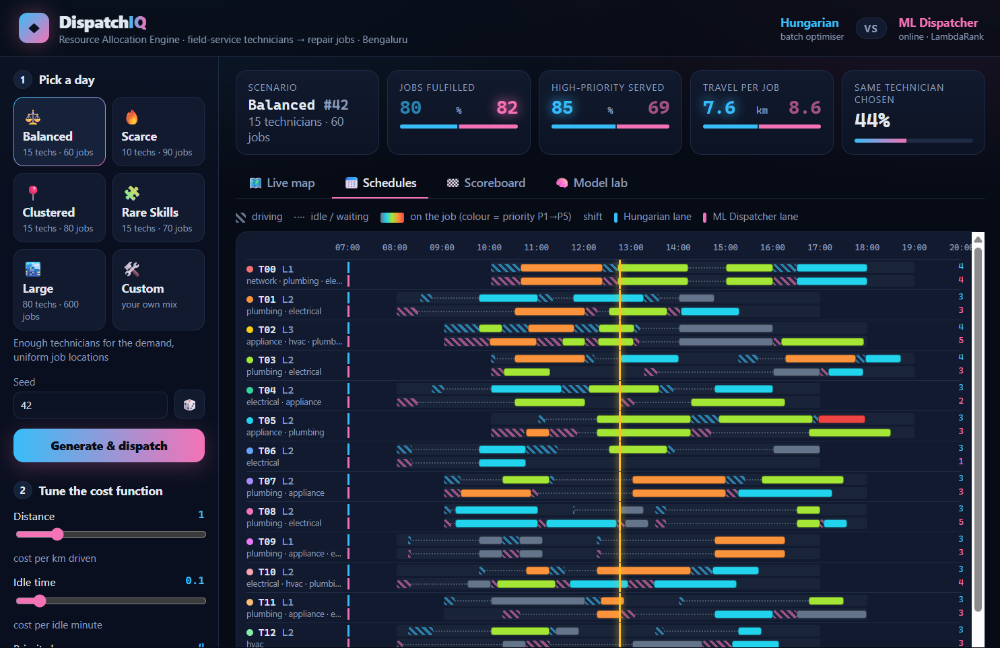 | 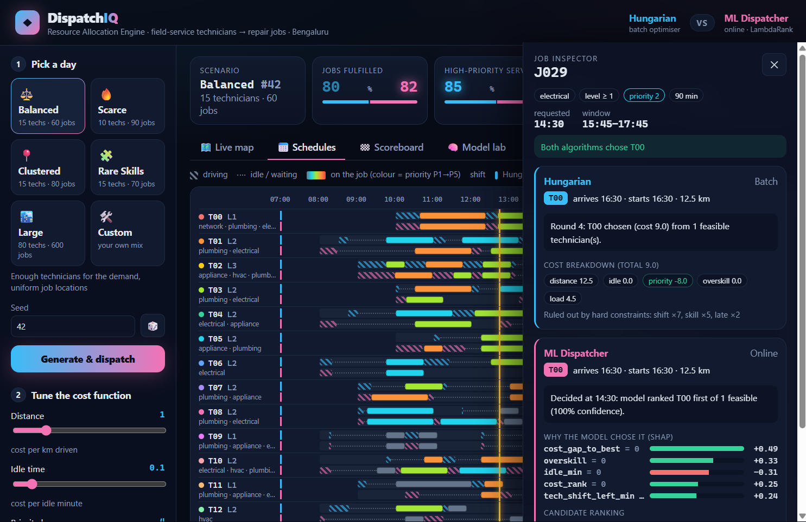 |

| Scoreboard | Model lab |
|---|---|
| 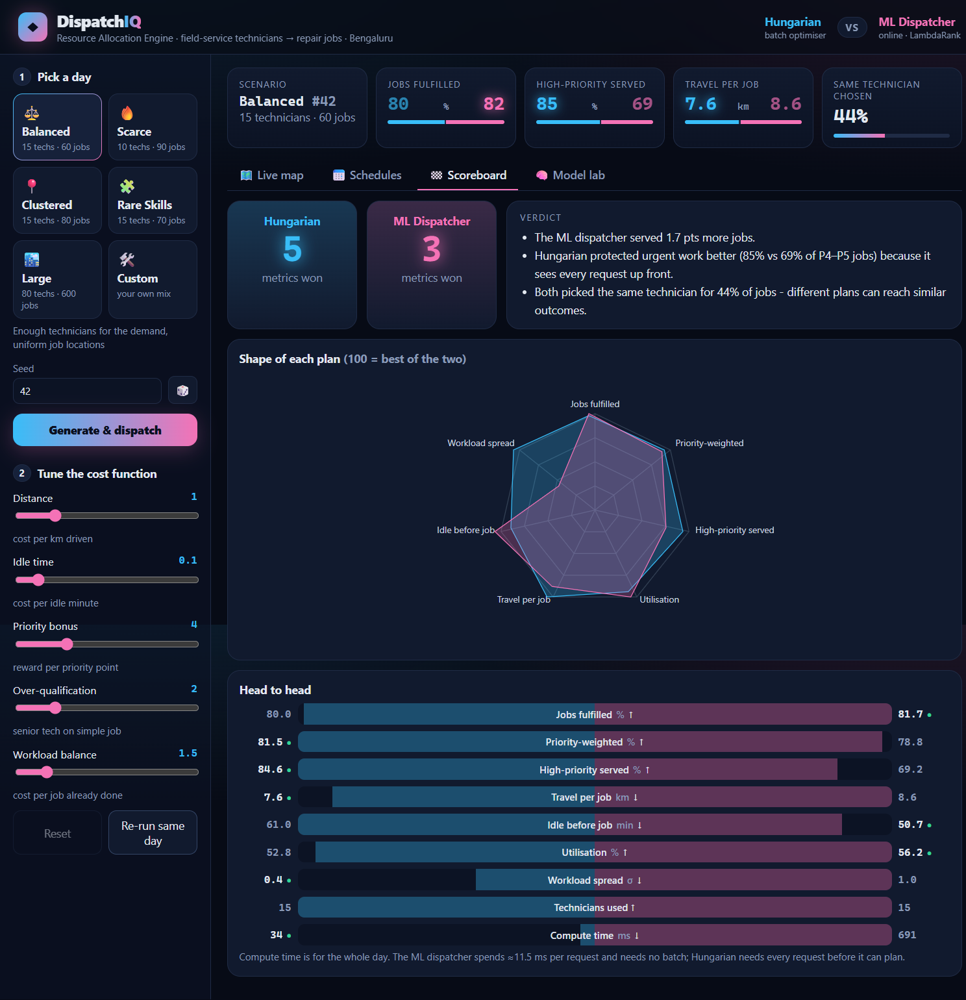 | 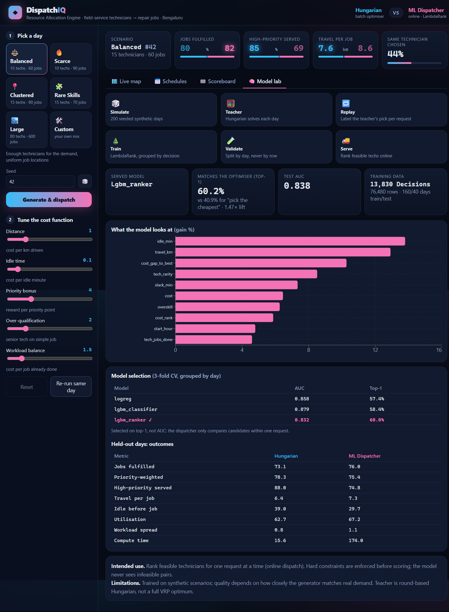 |

---

## 3. Architecture: six views

### 3.1 System context: who talks to what

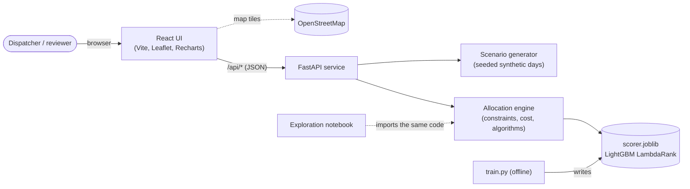

### 3.2 Layers and modules: how the code is organised

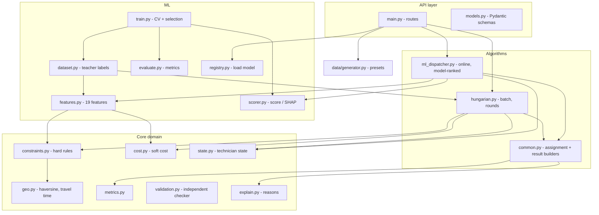

The core domain has no knowledge of ML or HTTP. Both algorithms share **the same constraint, cost and state code**,
so the comparison is fair by construction.

### 3.3 Runtime: what happens when you click *Generate & dispatch*

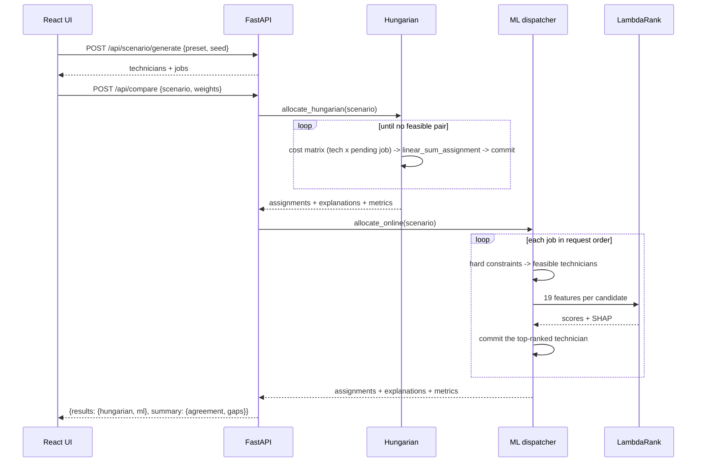

### 3.4 Offline ML pipeline: how the model is built

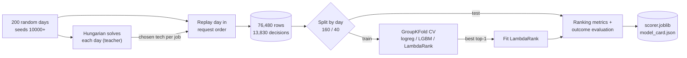

### 3.5 Data model

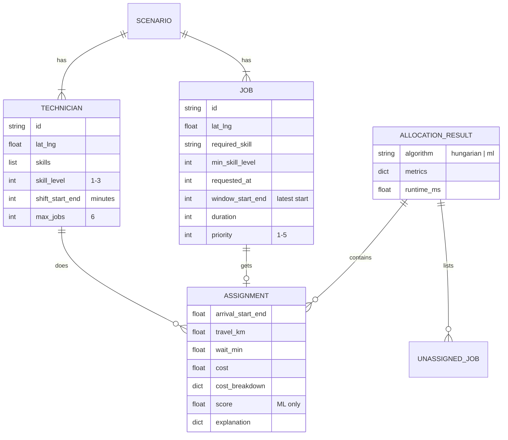

### 3.6 Job lifecycle (what the map colours mean)

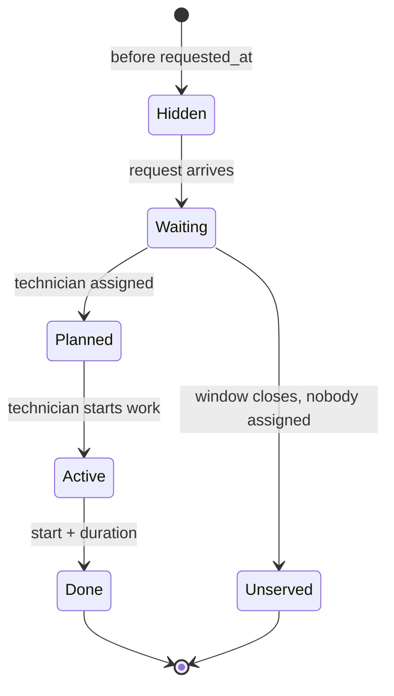

The frontend follows the same structure: `App` holds the state; `ControlRail`, `MapView ×2` + `Timeline`,
`ScheduleView`, `Scoreboard`, `ModelLab` and `JobDrawer` are pure views of `{scenario, results, time, selectedJob}`.

---

## 4. Data planning

### 4.1 Where the data comes from, and why it's synthetic

The brief provides no data. I looked at free public datasets:

| Dataset | What it has | Why it isn't enough on its own |
|---|---|---|
| NYC / Chicago 311 service requests | Real repair-type requests, locations, timestamps | No technicians, skills, shifts or assignments |
| Solomon VRPTW benchmarks | Customers, demands, time windows | Abstract x/y coordinates, no skills |
| Amazon Last-Mile Routing Challenge | Real delivery stops and time windows | Delivery, not skill-based service; very large |
| Olist e-commerce (Kaggle) | Orders with locations | No resources |
| OpenStreetMap | Real places and roads | Locations only |

**No public dataset contains the *resources* (technicians with skills and shifts) or past *assignments*.** So the
project uses a **seeded synthetic generator** ([`data/generator.py`](backend/app/data/generator.py)) placed on a
real map: the Bengaluru bounding box, lat 12.86–13.08, lng 77.48–77.72. This gives three things:
- **Reproducibility:** the same `(preset, seed)` always produces exactly the same day.
- **Control:** you can deliberately create scarcity, hotspots or rare-skill demand, which is where algorithms differ.
- **Unlimited labels** for ML: the optimiser can label any number of generated days.

A real 311 extract could later replace the job locations and times without changing anything else.

### 4.2 What the generator produces

| Entity | Field | Distribution |
|---|---|---|
| Technician | home location | uniform over the city |
| | skills | 1–3 of `electrical .30, plumbing .30, hvac .15, appliance .15, network .10` |
| | skill level | 1 / 2 / 3 with probability .4 / .4 / .2 |
| | shift | starts 08:00, 09:00 or 10:00, lasts 9 h |
| | max jobs | 6 |
| Job | location | uniform, or Gaussian around *k* hotspots (σ ≈ 1.3 km) |
| | required skill | same mix as technicians, optionally boosted toward rare skills (`hvac`, `network`) |
| | min level | 1 / 2 / 3 with probability .5 / .35 / .15 |
| | window | starts 08:30–17:00 (15-min steps), lasts 60/120/180 min (`window_end` = latest start) |
| | requested at | 1–3 h before the window opens (not before 07:00); drives the online arrival order |
| | duration | 30–120 min |
| | priority | 1–5 with probability .30 / .30 / .20 / .15 / .05 (most jobs routine, few urgent) |

All times are minutes after midnight. Travel time uses haversine distance at 25 km/h city speed, so no routing API
is needed.

### 4.3 Presets: five deliberately different days

| Preset | Techs | Jobs | Hotspots | Rare-skill boost | Jobs per tech slot* | What it stresses |
|---|---|---|---|---|---|---|
| ⚖️ `balanced` | 15 | 60 | 0 | 0 | 0.67 | A normal day; the baseline |
| 🔥 `scarce` | 10 | 90 | 0 | 0 | **1.50** | Demand exceeds capacity: who gets served? |
| 📍 `clustered` | 15 | 80 | 4 | 0 | 0.89 | Geographic contention; the nearest technicians get used up |
| 🧩 `rare_skills` | 15 | 70 | 0 | 0.5 | 0.78 | Many hvac/network jobs, few qualified technicians |
| 🏙️ `large` | 80 | 600 | 3 | 0.2 | 1.25 | City scale: runtime and drift |

\*`jobs ÷ (technicians × 6)`. Real capacity is lower because of travel, windows and skills, so even `balanced` only
reaches about 83 % fulfilment.

The rare-skill boost mixes the job skill distribution as
$p = (1-b)\cdot p_{base} + b\cdot p_{rare}$, while technicians keep the base mix. That creates a supply/demand
mismatch on purpose.

### 4.4 Seed plan (nothing overlaps)

| Use | Seeds |
|---|---|
| UI default | 42 |
| Benchmark | 1–5 per preset |
| **Model training** | 10000–10199 (200 random configurations) |
| Test fixtures | 500+, 900+, 7000+ |

The model is never evaluated on a day it was trained on.

### 4.5 The training dataset: what one row is

Each row is **one candidate technician for one job, at the moment the request arrives**. All candidate rows for the
same job form one **decision**. The label is 1 for the technician the Hungarian optimiser chose and 0 for the
others.

Real sample (training day 0, decision 1):

| decision | label | travel_km | idle_min | slack_min | tech_jobs_done | cost_rank | cost | tech_rarity |
|---|---|---|---|---|---|---|---|---|
| 1 | 0 | **0.86** | 0 | 103 | 1 | **0** (cheapest) | −5.64 | 1.3 |
| 1 | 0 | 13.61 | 42 | 180 | 0 | 3 | 11.84 | 0.9 |
| 1 | **1** | 15.30 | 0 | **158** | **0** | 1 | 7.30 | 1.3 |
| 1 | 0 | 18.13 | 0 | 151 | 0 | 2 | 10.13 | 1.8 |

In this decision the optimiser **didn't** pick the technician 0.86 km away. That technician was already busy and had
little slack. A fresh technician with a bigger time buffer got the job instead. Learning *when* to override the
cheapest option is the whole point of the model.

**Dataset size:** 200 days → **76,480 rows, 13,830 decisions**, about 5.5 candidates per decision. 11 % of
decisions have only one candidate; they're kept for training but excluded from accuracy metrics.

**How 200 days become 76,480 rows.** A *day* (scenario) is one simulated working day. The training days are
drawn by [`random_scenarios`](backend/app/ml/dataset.py) so the model sees many conditions: 6–30 technicians,
3–8 jobs per technician, uniform or 2/3/5 hotspots, and a rare-skill boost of 0, 0.3 or 0.5. Each stage below
filters or expands the previous one:

| Stage | Count | What happens |
|---|---|---|
| Simulated days | 200 | Seeds 10000–10199; on average 18.8 technicians and 100 jobs per day |
| Technicians / jobs generated | 3,757 / 20,099 | 23–214 jobs per day |
| Jobs the teacher assigns | ≈ 14,610 (73 %) | Hungarian plans each full day; the rest can't be served in time with the right skill, so they have no label |
| **Decisions** kept | **13,830** (94.7 % of teacher assignments) | The day is replayed in request order. If the teacher's technician isn't feasible at that point in the replay, the job is skipped |
| **Rows** | **76,480** | One row per feasible technician per decision (≈ 5.5 each) |

**Target and inputs.** Each row is one (job, candidate technician) pair:

| Role | Variable | Values |
|---|---|---|
| **Dependent variable (y)** | `label`: did the teacher assign this technician to this job? | 1 for exactly one row per decision, 0 for the rest |
| **Independent variables (X)** | The 19 features in §4.6 | Numeric, computed at the moment the request arrives |
| Grouping (not a feature) | `decision_id`, `scenario_id` | Tells the ranker which rows compete; the day ID drives the train/test split |

The model learns a score for each candidate such that, within one decision, the teacher's technician ranks first.

### 4.6 The 19 features, in plain words

All features are computed in [`ml/features.py`](backend/app/ml/features.py), using **only information available at
decision time**. The same code runs in training and in serving, so the two can't drift apart.

| Group | Feature | Meaning |
|---|---|---|
| **Geometry and time** | `travel_km` | Distance from the technician's *current* position (home or last job) |
| | `idle_min` | Waiting time before the job can start |
| | `slack_min` | How much earlier than the latest allowed start the technician would begin |
| | `start_hour` | Planned start time (9.75 = 09:45) |
| **Cost-derived** | `cost` | Soft cost of this pair (formula in §5.2) |
| | `cost_rank` | 0 = cheapest candidate for this job |
| | `cost_gap_to_best` | How much more expensive than the cheapest candidate |
| **Skill and scarcity** | `overskill` | Technician level minus required level (wasting seniority) |
| | `tech_skill_level`, `tech_n_skills` | Seniority and versatility |
| | `tech_rarity` | Sum over the technician's skills of (1 − share of fleet with that skill). High = holds rare skills, so worth saving |
| | `job_skill_supply` | Share of the fleet qualified for this job |
| **Load and capacity** | `tech_jobs_done`, `tech_capacity_left`, `tech_shift_left_min` | How busy the technician is and how much day is left |
| **Job context** | `priority`, `job_duration`, `window_len`, `n_feasible` | The same for every candidate in a decision; the trees use them for interactions |

**No IDs and no raw coordinates.** This forces the model to learn general rules instead of memorising specific
technicians or neighbourhoods.

### 4.7 Feature engineering techniques

| # | Technique | Features | Why |
|---|---|---|---|
| 1 | **Pairwise, grouped rows** (learning-to-rank format) | All | The unit is a (job, technician) pair, grouped by decision, so the ranker compares candidates within one decision |
| 2 | **Hard-constraint filtering before features** | All | [`feasible_candidates`](backend/app/ml/features.py) drops technicians who fail skill, level, capacity, window or shift checks. The model never sees invalid options and spends its capacity on choosing *between* valid ones |
| 3 | **Trip simulation** | `travel_km`, `idle_min`, `start_hour` | [`evaluate_pair`](backend/app/core/constraints.py) computes haversine distance from the technician's *current* position, departure = max(free at, requested at), arrival, start = max(arrival, window opens), and idle time |
| 4 | **Headroom features** (distance to a limit) | `slack_min`, `overskill`, `tech_capacity_left`, `tech_shift_left_min` | Differences against a limit (window close, required level, max jobs, shift end) mean the same thing at any time of day; 5 min of slack is risky whenever it happens |
| 5 | **Live state features** | `tech_jobs_done`, `tech_capacity_left`, `tech_shift_left_min` | Read from each technician's state, which is updated after every committed job, so the same technician looks different at 09:00 and 15:00 |
| 6 | **Within-decision relative features** | `cost_rank`, `cost_gap_to_best`, `n_feasible` | Raw cost isn't comparable across decisions. Rank (double `argsort`, stable ties) and gap to the cheapest candidate rescale it *within* the decision; `n_feasible` measures how contested the job is |
| 7 | **Heuristic score as a feature** | `cost` | The rule-based weighted cost (§5.2) is a strong prior. The model only has to learn *when to override* it: cheapest-option top-1 0.41 → model 0.60 |
| 8 | **Scarcity encoding instead of one-hot skills** | `job_skill_supply`, `tech_rarity` | [`FeatureContext`](backend/app/ml/features.py) computes, once per day from the roster only, the share of technicians qualified for each (skill, level), and per technician Σ(1 − share of fleet with skill), an IDF-like weight. "Rare" generalises across days; skill names don't |
| 9 | **Plain attributes** | `priority`, `job_duration`, `window_len`, `tech_skill_level`, `tech_n_skills` | Used as-is; trees learn interactions such as priority × slack |

**Leakage and consistency controls**
- **Decision-time information only.** Day-level context comes from the technician roster, never from future jobs.
- **One function for training and serving.** `candidate_features` is called by both
  [`build_dataset`](backend/app/ml/dataset.py) and [`allocate_online`](backend/app/algorithms/ml_dispatcher.py),
  so there's no train/serve skew.
- **Teacher forcing.** During dataset building the teacher's choice is committed, so state features follow the
  teacher's plan and labels stay consistent.

**Deliberately not done**

| Technique | Why not |
|---|---|
| Scaling | Trees don't need it; only the logistic-regression baseline uses `StandardScaler` |
| One-hot encoding | Replaced by scarcity encoding (row 8) |
| Imputation | Every value is computed, so nothing is missing |
| Feature selection | 19 features is small; LightGBM samples 80 % of columns per tree, and importance is reported instead |
| Hand-made interactions | Trees learn them |

---

## 5. Constraints

### 5.1 Hard constraints: a pair is either allowed or rejected with a reason

Implemented in [`core/constraints.py`](backend/app/core/constraints.py). Each rejection carries a reason code, which
the UI shows as "Ruled out by hard constraints: skill ×5, late ×2".

| Code | Rule | Formula |
|---|---|---|
| `skill` | The technician has the required skill | $s_j \in S_t$ |
| `level` | Skill level is high enough | $L_t \ge \ell_j$ |
| `capacity` | Under the daily job limit | $\text{jobs}_t < 6$ |
| `late` | Can arrive before the window closes | $\text{start} = \max(\text{depart} + \tau,\ e_j) \le l_j$ |
| `shift` | Finishes before the shift ends | $\text{start} + d_j \le \text{shift\_end}_t$ |

Here $\text{depart} = \max(\text{free}_t,\ r_j)$: **a technician cannot leave before the request exists.** Without
this rule, the batch algorithm could use information it couldn't actually have.

Routes are **append-only**: a job is always added after the technician's last job. That makes overlapping jobs
impossible by construction.

### 5.2 Soft constraints: a cost to minimise

Implemented in [`core/cost.py`](backend/app/core/cost.py) and adjustable with the UI sliders:

$$
\text{cost} = \underbrace{1.0\cdot km}_{\text{distance}} + \underbrace{0.1\cdot idle}_{\text{waiting}} + \underbrace{2\cdot(L_t-\ell_j)}_{\text{over-qualification}} + \underbrace{1.5\cdot jobs\_done}_{\text{balance}} - \underbrace{4\cdot priority}_{\text{bonus}}
$$

The priority term is a **bonus**. It doesn't change which technician is best for one job, but it makes urgent jobs
win when jobs compete for the same technicians in the batch solver.

### 5.3 Independent validator

[`core/validation.py`](backend/app/core/validation.py) **replays every route from scratch** and re-checks every
hard constraint: qualification, travel time, windows, shift, capacity and duplicates. It shares no state with the
algorithms, so it catches bugs the algorithms can't see in themselves. Tests run it on every preset for both
algorithms.

---

## 6. The two algorithms

| | **Hungarian (batch)** | **ML Dispatcher (online)** |
|---|---|---|
| Sees | All requests for the day | Only the current request and the current fleet state |
| Decides | In rounds, each round solved optimally | One request at a time, immediately |
| Core | `scipy.optimize.linear_sum_assignment` | LightGBM LambdaRank ranking feasible technicians |
| Explanation | Round, rank by own cost, cheaper alternatives | SHAP contributions, confidence, ranking |
| Real-world fit | Next-day planning | Same-day dispatch |

### 6.1 Hungarian in rounds ([`algorithms/hungarian.py`](backend/app/algorithms/hungarian.py))

The Hungarian / Kuhn-Munkres algorithm solves a **one-to-one** matching, but a technician does several jobs a day.
So it runs in rounds:

```
while jobs remain and someone has capacity:
    build matrix C[tech, job] = cost if feasible else 1e9    # from each technician's CURRENT position/time
    solve C optimally; keep pairs below 1e9; append to routes
```

- **Why 1e9:** SciPy needs finite costs. A huge value means the solver only uses an infeasible pair if it has no
  other choice, and such pairs are then dropped.
- **Complexity:** each round is $O(n\cdot m)$ evaluations plus $O(n^2 m)$ for the assignment. Measured: 5 ms for
  15×60 and about 0.4 s for 80×600.
- **Known weakness:** every round forces each technician to take its best job *for that round*, sometimes one late
  in the day. That creates idle gaps, and you can see them in the Schedules tab.

### 6.2 ML Dispatcher ([`algorithms/ml_dispatcher.py`](backend/app/algorithms/ml_dispatcher.py))

```
for job in jobs sorted by requested_at:
    candidates = technicians passing ALL hard constraints
    scores = model(features(job, candidates))
    commit the top-ranked technician; explain with SHAP
```

**Safety by design:** the model only ranks candidates that already passed every hard constraint. A bad model can
produce a *worse* plan, never an *invalid* one.

### 6.3 Why exactly these two

- **The brief requires at least two strategies.** I first planned three (Greedy, Hungarian, a regret heuristic),
  then narrowed it to two that tell **one coherent story**: batch optimum vs a learned online policy. Hungarian is
  also the ML model's teacher, so the two algorithms are connected rather than independent.
- **The question the brief asks** ("when does step-by-step win, when does batch win?") becomes: *can a model
  trained on optimal batch decisions make good decisions one request at a time?*
- **The case for ML here is not speed.** At these sizes Hungarian is fast. The case is **deciding immediately
  without waiting for a batch**, which is how real dispatch works.

---

## 7. ML planning

### 7.1 Framing

| Question | Decision | Reason |
|---|---|---|
| What does the model learn? | To **imitate** the Hungarian optimiser (behavioural cloning) | The objective is already encoded by an optimiser that can label unlimited synthetic days |
| Why not reinforcement learning? | Not needed | It would need a simulator, reward shaping and much more tuning; it's only justified when you want to *beat* the teacher |
| Classification or ranking? | **Ranking (LambdaRank)** | Each decision has exactly one right answer among N candidates; only the order *within* a decision matters |
| How are labels made? | **Teacher forcing**: replay each day, commit the teacher's choice, record features for every candidate | Keeps labels well-defined. 94.7 % of the teacher's decisions can be replayed online; the rest are skipped, not mislabelled |

### 7.2 Workflow: notebook first, then production code

The exploration happens in [`backend/notebooks/01_model_exploration.ipynb`](backend/notebooks/01_model_exploration.ipynb).
It's executed, with 13 plots, and every section ends in a decision. The notebook **imports** the production modules
rather than copying them, so whatever it concludes is exactly what [`train.py`](backend/app/ml/train.py) automates
and the API serves.

| Notebook section | Finding | Carried into production |
|---|---|---|
| Is there signal? | The optimiser picks the cheapest technician in only **39.7 %** of decisions | Use a learned scorer |
| Baselines | Random 0.23 · least-idle 0.16 · cheapest 0.40 · **nearest 0.43** top-1 | The bar to beat is 0.43 |
| Split / leakage test | Split by day 0.600 vs leaky split 0.601: no gap on synthetic data (relative features, independent days) | Keep the day-level split; use a time-based split on real data |
| Model comparison | logreg 0.574 · LGBM classifier 0.584 · **LambdaRank 0.600** top-1. LambdaRank has the *lowest* AUC. | Select on **top-1**, not AUC |
| Tuning | Flat around the defaults; bigger models over-fit | 31 leaves, 300 trees |
| Learning curve | Plateaus after about 80 days | 200 days is enough; more data won't help |
| Feature ablation | Geometry/time −4.3 pts, skill scarcity −2.9 pts, cost-derived ≈ 0 | Keep all (they make explanations readable) |
| Calibration | Softmax confidence roughly matches accuracy (0.82 → 0.86) | Shown as "confidence" in the UI |
| SHAP | Slack ↑, distance ↓, over-qualification ↓, rarity ↓, load ↓. **Idle ↑**, a habit copied from the teacher | The fix belongs in the teacher, not the model |
| Outcomes | ML +3 pts fulfilment, higher utilisation; Hungarian +13 pts on high-priority | Documented trade-off |
| Scale | Agreement 0.45 → 0.12 as the fleet grows (compounding error); about 2 ms per request | Next step: DAgger |

### 7.3 Metrics: why AUC is the wrong yardstick here

| Metric | Meaning | Role |
|---|---|---|
| **Top-1** | The model's first choice equals the optimiser's choice | **Primary** |
| Top-2 / MRR | How close the right answer is to the top | Supporting |
| AUC | Pooled over all rows, across decisions | Diagnostic only |

AUC compares a candidate in one decision with a candidate in another decision, which the dispatcher never does.
LambdaRank optimises ordering *within* a decision, so it wins on top-1 while losing on AUC. That's the expected
result, not a contradiction.

### 7.4 Served model ([`models/model_card.json`](backend/models/model_card.json))

| | |
|---|---|
| Model | LightGBM `LGBMRanker(objective="lambdarank")`, 300 trees, 31 leaves |
| Test top-1 / top-2 / MRR / AUC | **0.602** / 0.837 / 0.764 / 0.839 (40 unseen days) |
| Explanations | LightGBM's native exact TreeSHAP (`pred_contrib=True`), no extra dependency |
| Latency | about 1.5–2.3 ms per request including SHAP (single-threaded: candidate sets are tiny) |
| Retrain | `python -m app.ml.train`; seeded, so identical metrics every time |

### 7.5 Training pipeline, end to end: from data to saved model

`python -m app.ml.train --n-scenarios 200 --seed 10000` runs every step below in about 16 s
([`ml/train.py`](backend/app/ml/train.py)).

1. **Generate days.** 200 seeded random days (§4.5).
2. **Split by day, first.** A seeded permutation puts 160 days in training and 40 in test. An `assert` fails if any
   day appears on both sides. Test days are never used for training or model selection.
3. **Label with the teacher.** Hungarian solves each full day and records the technician chosen for each job.
4. **Replay and build rows.** Each day is replayed in request order. For every job: filter the feasible technicians,
   compute the 19 features, label the teacher's choice 1, then commit the teacher's choice (teacher forcing).
   Result: 13,830 decisions, 76,480 rows.
5. **Try three models.**

   | Model | Type | Settings |
   |---|---|---|
   | Logistic regression | Linear baseline, pointwise | `StandardScaler` + `LogisticRegression(max_iter=2000)` |
   | LightGBM classifier | Pointwise trees | 300 trees, learning rate 0.05, 31 leaves, 80 % row and column sampling |
   | LightGBM ranker | Listwise, `lambdarank` | Same settings, plus group sizes so each decision is ranked as a unit |

6. **Cross-validate on the training days.** `GroupKFold(3)` grouped by day ([`ml/evaluate.py`](backend/app/ml/evaluate.py)):

   | Model | CV AUC | CV top-1 |
   |---|---|---|
   | Logistic regression | 0.858 | 0.574 |
   | LightGBM classifier | **0.879** | 0.584 |
   | **LightGBM ranker** | 0.832 | **0.600** |
   | Cheapest-option baseline | – | 0.394 |

7. **Select and refit.** The model with the best CV top-1 (the ranker) is retrained on all 160 training days.
8. **Test once.** Ranking metrics on the 40 held-out days: top-1 0.602 against 0.409 for the cheapest option. CV and
   test agree, so there's no over-fitting.
9. **Business evaluation.** Full-day simulations on the 40 test days, Hungarian vs ML (§9). Here the model's own
   choices drive the day, with no teacher forcing, so one different pick changes every later state. That's why
   assignment agreement is only 38 % even though top-1 is 60 %.
10. **Explain.** Global gain importance, per-decision TreeSHAP contributions (top 5 shown in the Job Inspector), and
    a softmax over candidate scores as confidence ([`ml/scorer.py`](backend/app/ml/scorer.py)).
11. **Save.** Two files in [`backend/models/`](backend/models):
    - `scorer.joblib`: a `Scorer` wrapper (model kind, trained model, feature names, model card) saved with `joblib`,
      exposing one API (`score`, `confidence`, `contributions`) for all three model types.
    - `model_card.json`: data sizes, split, seed, CV and test metrics, business results, feature importance, intended
      use and limitations.
12. **Load and serve.** [`get_scorer`](backend/app/ml/registry.py) loads the model once and caches it. If the file is
    missing, or was saved with incompatible library versions, it trains a quick 60-day model instead.
    [`allocate_online`](backend/app/algorithms/ml_dispatcher.py) then filters, featurises, scores, picks the top
    candidate, records the explanation and commits it for each request.

---

## 8. Testing

The goal of the tests is to *prove* the important properties, not just exercise code. 33 tests run in about 3 s.

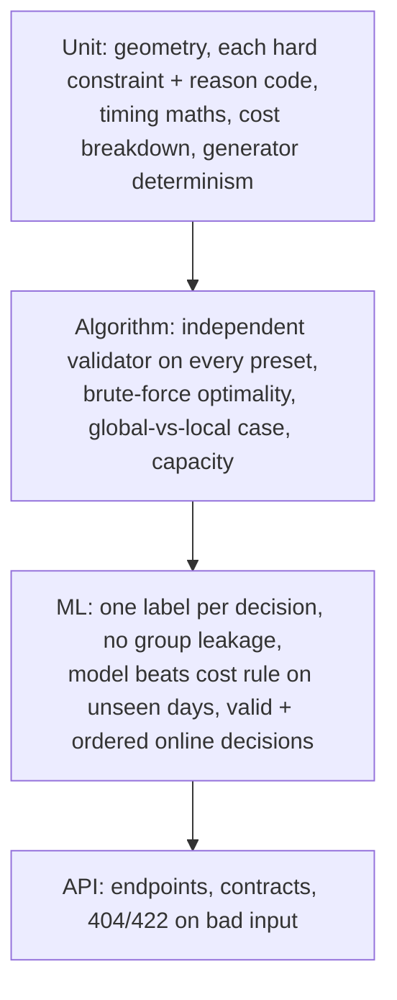

| Property | How it's proven | Test |
|---|---|---|
| Every assignment is valid | The independent validator replays routes for **both** algorithms on **every** preset | `test_hungarian_respects_all_hard_constraints`, `test_ml_dispatcher_respects_hard_constraints` |
| Hungarian is actually optimal per round | Compared with **brute force over all permutations** on a 4×4 case | `test_hungarian_matches_brute_force_on_single_round` |
| Batch thinks globally | A hand-built case where the cheapest technician is the only HVAC tech; Hungarian assigns the other technician and the explanation shows rank 2 | `test_batch_sacrifices_local_cost_for_global_optimum` |
| Each hard constraint works | One parametrised case per reason code | `test_hard_constraints_reject_with_reason` |
| No departure before the request | Arrival computed from `requested_at` | `test_cannot_depart_before_request` |
| Dataset integrity | Exactly one positive per decision; one scenario per decision | `test_dataset_has_one_label_per_decision` |
| The model learned something | Beats the cheapest rule's top-1 on **unseen** seeds | `test_model_beats_cost_ranking_on_unseen_scenarios` |
| Online means online | Decisions follow request order | `test_online_dispatch_follows_request_order` |
| Explanations are complete | 5 SHAP factors, confidence in (0, 1], summary | `test_ml_explanations` |
| API contract | Generate → compare → two results; unknown preset 404; unknown algorithm 422 | `test_api.py` |

ML tests train a **small model inside a pytest fixture**, so they don't depend on the saved artefact. The
notebook (executed end to end) and `benchmark.py` act as reproducible evidence for every number in this README.

---

## 9. Results in one page

Held-out evaluation, 40 unseen days:

| | Hungarian (batch) | ML Dispatcher (online) |
|---|---|---|
| Jobs fulfilled | 73.1 % | **76.0 %** |
| Priority-weighted | **78.3 %** | 75.4 % |
| High-priority (P4–P5) served | **88.0 %** | 74.8 % |
| Travel per job | **6.4 km** | 7.3 km |
| Idle before job | 39.0 min | **29.7 min** |
| Utilisation | 62.7 % | **67.2 %** |
| Workload spread (σ) | **0.84** | 1.09 |

**In one sentence:** the batch optimiser protects urgent work because it sees every request, while the online ML
dispatcher serves more jobs and keeps technicians busier. It decides instantly, but can't hold capacity for an
urgent request that hasn't arrived yet.

Per-preset numbers and a deeper discussion are in [ANALYSIS.md](ANALYSIS.md).

---

## 10. Decision log

| Decision | Alternatives considered | Why |
|---|---|---|
| Field-service domain | Delivery fleet, healthcare, equipment rental | Skills, levels and time windows give rich hard constraints and real scarcity |
| Synthetic seeded data on a real city | Public datasets (§4.1) | No public dataset has resources or assignments; synthetic data is reproducible and controllable |
| Two algorithms | Three or more (Greedy, Regret, ...) | One focused story: batch optimum vs learned online policy |
| ML as the second algorithm | Hand-written heuristic | The online setting is where ML adds value; it also shows a proper ML workflow |
| Imitation learning | Reinforcement learning | Stable, data-efficient, the teacher already encodes the objective |
| LambdaRank | Pointwise classifier | Choosing one of N is a ranking problem; it was empirically best on top-1 |
| Hard constraints before the model | Let the model learn feasibility | Guarantees valid plans |
| Split by day | Row-level split | Rows from one day are correlated; day-level splitting stays valid on real data |
| Notebook → modules | Notebook only / scripts only | Exploration is visible; production code is tested and reproducible |
| Native TreeSHAP | `shap` package | Exact, fast, no heavy dependency |

---

## 11. Limitations and next steps

1. **Synthetic world.** The model learns the generator. Next: real dispatch history with a time-based split, plus
   drift monitoring.
2. **Teacher ceiling.** Round-based Hungarian isn't a full routing optimum. Next: an OR-Tools VRPTW teacher, which
   also removes the copied idle-time habit.
3. **Compounding error.** Agreement drops on larger days. Next: **DAgger** (label the states the model visits).
4. **High-priority gap online.** Next: a priority-aware hold, or rolling 15-minute Hungarian micro-batches.
5. **Weights.** The model was trained with default weights; changing the sliders changes the optimiser's objective
   but not the model. Next: condition the model on the weights.

---

## 12. Project layout and API

```
backend/
  app/
    main.py, models.py          API + schemas
    core/                       constraints, cost, state, geo, metrics, validation, explain
    algorithms/                 hungarian.py, ml_dispatcher.py, common.py
    ml/                         features, dataset, train, evaluate, scorer, registry
    data/generator.py           seeded scenarios + presets
  models/                       scorer.joblib, model_card.json
  notebooks/                    01_model_exploration.ipynb (executed)
  results/benchmark.json        output of benchmark.py
  tests/                        33 pytest tests
  requirements.txt, requirements-dev.txt, benchmark.py
frontend/
  src/App.tsx                   state + layout
  src/components/               ControlRail, MapView, Timeline, ScheduleView, Scoreboard, JobDrawer, ModelLab
docs/
  TECHNICAL_GUIDE.md            deeper technical walkthrough
  images/                       screenshots
ANALYSIS.md                     algorithm comparison write-up
```

| Method | Path | Body / response |
|---|---|---|
| GET | `/api/health` | `{status}` |
| GET | `/api/presets` | preset configurations |
| POST | `/api/scenario/generate` | `{preset?, seed, n_techs, n_jobs, clusters, rare_skill_boost}` → scenario |
| POST | `/api/allocate` | `{scenario, algorithm: "hungarian" \| "ml", weights}` → result |
| POST | `/api/compare` | `{scenario, weights}` → `{results: {hungarian, ml}, summary}` |
| GET | `/api/model` | model card |

Interactive API docs are at http://127.0.0.1:8000/docs.

**Submission checklist**

| Guideline | Where |
|---|---|
| `node_modules` excluded | Not shipped; created by `npm install`. Also excluded: `.venv`, `dist`, caches. |
| Python dependencies | [`backend/requirements.txt`](backend/requirements.txt), plus [`requirements.txt`](requirements.txt) at the root pointing to it. Notebook extras are in `backend/requirements-dev.txt`. |
| Frontend dependencies | [`frontend/package.json`](frontend/package.json) + `package-lock.json` (so `npm install` gets exact versions) |
| Start instructions | [§1 Quick start](#1-quick-start) |

**More depth:** [docs/TECHNICAL_GUIDE.md](docs/TECHNICAL_GUIDE.md) (formulation, complexity, the full ML evidence
chain) · [notebook](backend/notebooks/01_model_exploration.ipynb) · [ANALYSIS.md](ANALYSIS.md).
