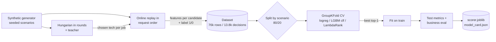
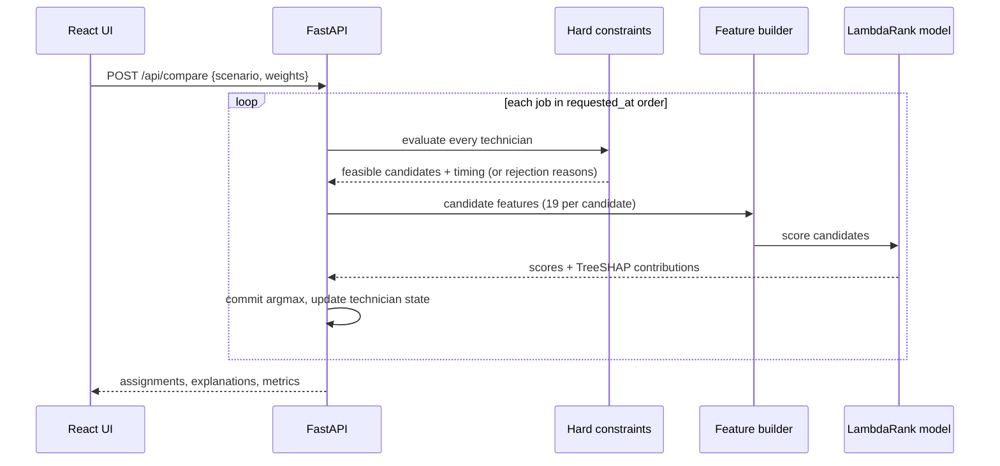

# Technical Guide: Resource Allocation Engine

This is a deep technical walkthrough of the whole system: what it does, how data flows, why each design decision was
made, and what the evidence shows. Sections 1 to 10 explain the system. Section 11 is interview preparation
(a demo script, likely questions with answers, and a numbers cheat-sheet).

> **Companion artefacts**
> - [`backend/notebooks/01_model_exploration.ipynb`](../backend/notebooks/01_model_exploration.ipynb): the ML research log, executed, with plots
> - [`ANALYSIS.md`](../ANALYSIS.md): algorithm comparison write-up
> - [`backend/models/model_card.json`](../backend/models/model_card.json): what the served model is, how it was trained, how it scored

---

## 1 · The 30-second pitch

> "I built a field-service dispatcher that assigns technicians to repair jobs under hard constraints (skills, time
> windows, shifts, capacity) and soft preferences (distance, idle time, priority, over-qualification, workload).
> I compare two strategies. The first is a **batch optimiser**: the Hungarian algorithm, solved in rounds, which sees
> the whole day. The second is an **online ML dispatcher**: a LightGBM LambdaRank model trained by *imitation learning*
> to reproduce the optimiser's choices one request at a time, with only information available at that moment.
> The ML policy matches the optimiser's choice 60 % of the time vs 41 % for a cost rule, fulfils about 3 points more
> jobs than the batch optimiser, but serves fewer high-priority jobs. That gap is structural to online decision-making,
> and I can show exactly where it comes from."

---

## 2 · End-to-end flow

### 2.1 Offline (training)



### 2.2 Online (serving one request)



The **same** feature code ([`app/ml/features.py`](../backend/app/ml/features.py)) is used in training and serving.
This removes training/serving skew by construction.

### 2.3 Request lifecycle in the UI

1. The user picks a preset card and seed. `POST /api/scenario/generate` returns technicians and jobs.
2. `POST /api/compare` immediately runs Hungarian and the ML dispatcher on the **same** scenario.
3. The UI shows four views of the result:
   - **Live map:** two synced maps with a day-playback timeline (technicians drive their routes).
   - **Schedules:** a Gantt chart with one Hungarian lane and one ML lane per technician.
   - **Scoreboard:** a radar chart, head-to-head metrics and an auto-generated verdict.
   - **Model lab:** the model card.

   Clicking any job opens the job inspector, which shows both algorithms' explanations side by side.

---

## 3 · Problem formulation

**Entities** (all times in minutes after midnight):

| Technician $t$ | Job $j$ |
|---|---|
| home $(lat, lng)$, skills $S_t$, level $L_t \in \{1,2,3\}$ | location, required skill $s_j$, min level $\ell_j$ |
| shift $[a_t, b_t]$, capacity $K_t$ | requested at $r_j$, window $[e_j, l_j]$ (latest **start**), duration $d_j$, priority $p_j \in 1..5$ |

**Travel**: haversine distance at 25 km/h city speed (no routing API, which satisfies the "no paid services" constraint).

**Hard constraints** for appending job $j$ to technician $t$'s route ([`core/constraints.py`](../backend/app/core/constraints.py)):

$$
s_j \in S_t,\quad L_t \ge \ell_j,\quad |\text{route}_t| < K_t
$$
$$
\text{depart} = \max(\text{free}_t,\ r_j),\quad \text{start} = \max(\text{depart} + \tau,\ e_j) \le l_j,\quad \text{start} + d_j \le b_t
$$

Two design choices are worth calling out:
- A technician **cannot depart before the request exists** ($r_j$). Without this, the batch algorithm would use
  information it couldn't have, and the comparison with the online algorithm would be unfair.
- Routes are **append-only** (no insertion between existing jobs), so overlaps are impossible by construction.

**Soft cost** of a feasible pair ([`core/cost.py`](../backend/app/core/cost.py)), lower is better:

$$
c(t,j) = w_d \cdot km + w_i \cdot idle + w_o \cdot (L_t - \ell_j) + w_l \cdot jobs\_done_t - w_p \cdot p_j
$$

Defaults: $w_d=1/\text{km}$, $w_i=0.1/\text{min}$, $w_o=2$, $w_l=1.5$, $w_p=4$. The priority term is a **bonus**.
It doesn't change which technician is best for a given job, but it makes high-priority jobs win when jobs compete
for technicians in the batch solver.

**Full problem.** Choosing which jobs each technician does, in what order, under time windows, is a
**VRP with time windows (VRPTW)**, which is NP-hard. Both algorithms here are heuristics on top of that problem. The
Hungarian algorithm is exact only *per round*.

---

## 4 · Algorithm 1: Hungarian in rounds (batch)

File: [`algorithms/hungarian.py`](../backend/app/algorithms/hungarian.py)

```
pending = all jobs
while pending and some technician has capacity:
    C[i,k] = cost(tech_i, job_k) if feasible else 1e9          # n x m matrix from CURRENT state
    rows, cols = linear_sum_assignment(C)                     # optimal 1:1 matching for this round
    commit pairs with C < 1e9; update technician position/time/load
    remove committed jobs from pending
```

**Why rounds?** The Hungarian / Kuhn-Munkres algorithm solves a *one-to-one* assignment, but a technician does
several jobs a day. Each round optimally gives every technician at most one *next* job given where they are now.

**Why 1e9 instead of infinity?** `scipy.optimize.linear_sum_assignment` needs finite costs. A huge finite value
makes the solver use an infeasible pair only when there's no alternative. Those pairs are then filtered out.

**Complexity.** Each round costs $O(n \cdot m)$ feasibility and cost evaluations plus $O(n^2 m)$ for the rectangular
assignment ($n$ technicians ≤ $m$ jobs). The number of rounds $R$ is about the maximum jobs per technician. Measured:
5 ms for 10×75 and 717 ms for 80×600 (super-linear growth).

**Explanations per assignment:** the round number, number of feasible candidates, the chosen technician's rank by
its *own* cost, cheaper alternatives, and rejection counts by reason. When the rank is greater than 1, the summary
says the cheaper technician was used elsewhere by the global optimum. That's the essence of batch optimisation.

**Known weaknesses** (visible in the data):
- **Myopic per round.** Every technician is forced to take its best job *this round*, which is sometimes a late job.
  That causes long idle times and blocks earlier work. This is why Hungarian has the highest `avg_idle_min` and
  slightly lower fulfilment than the online policy.
- It needs **all requests in advance**, which is unrealistic for same-day dispatch.

---

## 5 · Algorithm 2: ML dispatcher (online)

File: [`algorithms/ml_dispatcher.py`](../backend/app/algorithms/ml_dispatcher.py)

```
for job in jobs sorted by requested_at:            # online: one request at a time
    candidates = feasible technicians (hard constraints FIRST)
    X = candidate_features(job, candidates)        # 19 features, information available now
    scores = model.score(X)                        # LambdaRank
    pick = argmax(scores); commit immediately
    explanation = TreeSHAP of pick, softmax confidence, ranking, cost-only choice
```

**Safety property:** the model only ever ranks candidates that already satisfy every hard constraint. A bad model
can give a *worse* plan, never an *invalid* one. This is tested in `test_ml_dispatcher_respects_hard_constraints`.

### 5.1 Features (19)

| Group | Feature | Why it should matter |
|---|---|---|
| Geometry / time | `travel_km` | Direct cost; dominates the teacher's objective |
| | `idle_min` | Wasted time before the job starts |
| | `slack_min` | Time between start and window close: robustness |
| | `start_hour` | Morning vs afternoon behaviour differs |
| Cost-derived | `cost`, `cost_rank`, `cost_gap_to_best` | What a greedy rule sees; lets the model decide how much to trust it |
| Skill & scarcity | `overskill` | Wasting a senior technician on an easy job |
| | `job_skill_supply` | Share of the fleet qualified for this job |
| | `tech_rarity` | Σ over the technician's skills of (1 − share of fleet with that skill): *option value* of keeping them free |
| | `tech_n_skills`, `tech_skill_level` | Versatility |
| Load & capacity | `tech_jobs_done`, `tech_capacity_left`, `tech_shift_left_min` | Balance and remaining availability |
| Job context | `priority`, `job_duration`, `window_len`, `n_feasible` | Group-level context that trees can interact with |

There are **no IDs and no raw coordinates**, so the model can't memorise individuals or places and has to generalise
to new days.

### 5.2 Scoring, confidence, explanation ([`ml/scorer.py`](../backend/app/ml/scorer.py))

- **Score:** raw LambdaRank output. Only differences within a decision are meaningful.
- **Confidence:** softmax of scores within the decision. It's roughly calibrated (section 6.8), which makes it
  usable as a routing signal (auto-dispatch above a threshold, human review below it).
- **Explanation:** `predict(X, pred_contrib=True)`, LightGBM's native **exact TreeSHAP**. The top 5 contributions
  are returned per assignment and drawn as green/red bars in the UI. No `shap` dependency is needed.
- **Latency:** `num_threads=1`. Candidate sets are tiny, so OpenMP thread start-up would otherwise dominate.
  Measured cost is about 1.4–2.3 ms per request including SHAP.

---

## 6 · ML pipeline in depth

Files: [`ml/dataset.py`](../backend/app/ml/dataset.py), [`ml/train.py`](../backend/app/ml/train.py),
[`ml/evaluate.py`](../backend/app/ml/evaluate.py). The evidence for every claim below is in the notebook.

### 6.1 Imitation learning with teacher forcing

1. Generate 200 random days (6–30 technicians, 3–8 jobs per technician, varied clustering and rare-skill demand).
2. Solve each day with Hungarian (the **teacher**).
3. **Replay** the day in request order. At each request, build features for every feasible candidate, label the one
   the teacher chose with 1, then **commit the teacher's choice** (teacher forcing) so the state follows the
   teacher's plan.
4. **Coverage is 94.7 %.** In 5.3 % of cases the teacher's technician is no longer feasible in the replay, because
   Hungarian builds routes round by round while the replay goes in arrival order. Those decisions are skipped
   rather than mislabelled.

**Dataset:** 76,480 candidate rows, 13,830 decisions (exactly one positive each), 5.5 candidates per decision on
average, 11 % trivial (only one candidate).

### 6.2 Is there anything to learn?

The teacher picks the locally cheapest technician in only **39.7 %** of non-trivial decisions. The other 60 % of
the time it accepts a higher local cost because that technician is worth more elsewhere. That opportunity cost is
invisible to a greedy rule, and it's what the model must infer.

### 6.3 Metrics and why AUC is the wrong selection metric

| Metric | Definition | Role |
|---|---|---|
| **Top-1** | Share of non-trivial decisions where the highest-scored candidate = teacher's pick | **Primary** |
| Top-2 | Teacher's pick is in the top 2 | Human-in-the-loop suggestions |
| MRR | Mean of 1/rank of the teacher's pick | Overall ranking quality |
| AUC | Pooled across all rows | Diagnostic only |

AUC compares candidates **across** decisions, but the dispatcher compares candidates **within** a decision. Trivial
decisions are excluded from top-k, because a single candidate is always "correct" and would inflate accuracy.

### 6.4 Baselines (full dataset)

| Rule | Top-1 | Note |
|---|---|---|
| Random (expected) | 0.233 | |
| Least idle | 0.158 | *Worse than random*: the teacher tolerates idle time (round artefact) |
| Cheapest (what a greedy rule picks) | 0.397 | |
| **Nearest** | **0.429** | Best rule. Distance is the cost term that survives global optimisation best |

### 6.5 Split protocol and the leakage test

- 20 % of **scenarios** are held out as the test set. Model selection uses `GroupKFold(groups=scenario_id)` on the
  remaining 80 %.
- **Leakage experiment:** a scenario-level split gave 0.600 top-1, and a leaky decision-level split gave 0.601, so
  there was **no gap**. That's because the synthetic days are independent and the features are relative (no IDs or
  coordinates). On real data (same technicians and areas every day) leakage *would* matter, so the strict protocol is
  kept. In production it becomes a **time-based** split.

### 6.6 Model comparison (3-fold scenario-grouped CV)

| Model | Top-1 | Top-2 | MRR | AUC* |
|---|---|---|---|---|
| Logistic regression | 0.574 | 0.803 | 0.742 | 0.846 |
| LightGBM classifier | 0.584 | 0.817 | 0.750 | **0.864** |
| **LightGBM LambdaRank** | **0.600** | **0.825** | **0.760** | 0.832 |
| Cheapest rule | 0.397 | 0.632 | 0.602 | 0.621 |

\*AUC here excludes trivial decisions. The model card's AUC includes them, so the values differ slightly.

**Key insight:** LambdaRank has the best ranking metrics but the *lowest* AUC. Pointwise log-loss optimises
separating positives from negatives globally, while LambdaRank optimises NDCG **within each query group**
(= decision), which is the quantity the dispatcher uses. Selecting by AUC would have picked the wrong model.

### 6.7 Tuning, data volume and features

- **Sweep:** results are flat around the defaults. 15 leaves / 200 trees and 31 leaves / 300 trees both give 0.600.
  More capacity over-fits: 63–127 leaves or 600 trees give 0.582–0.589. Defaults are kept.
- **Learning curve** (test top-1): 0.561 with 10 days, 0.589 with 40, 0.601 with 80, 0.602 with 160. It's flat
  after about 80 days, so **more data won't help**. The ceiling comes from what's observable online and from the
  teacher.
- **Feature-group ablation** (test top-1, full model 0.602):

| Removed | Δ top-1 |
|---|---|
| Geometry/time | **−4.3 pts** |
| Skill & scarcity | **−2.9 pts** |
| Load & capacity | −0.2 |
| Job context | −0.2 |
| Cost-derived | +0.5 (redundant: the model recombines raw parts better than our weighted sum) |
| *Only* cost-derived | 0.402 (≈ the cheapest rule, as expected) |

### 6.8 Final model on held-out test (40 unseen days)

| | Top-1 | Top-2 | MRR | AUC |
|---|---|---|---|---|
| **LambdaRank** | **0.602** | **0.837** | **0.764** | 0.839 |
| Cheapest rule | 0.409 | 0.655 | 0.615 | 0.620 |
| Random | 0.233 | 0.467 | 0.470 | 0.500 |

**Error analysis:**
- **By number of candidates:** top-1 is 0.78 with 2 candidates and 0.42 with 9 or more. Relative to random, the
  model is about 4–5× better in the hardest decisions.
- **When the teacher took the cheapest option:** the model agrees 78 % of the time.
- **When the teacher overrode cost** (59 % of decisions): the model agrees only 48 % of the time. Those overrides
  depend on *future* jobs and other technicians' plans, which no online policy can observe. This is the irreducible
  batch-vs-online gap.

**Calibration:** stated confidence 0.38 → observed 0.41, 0.52 → 0.54, 0.67 → 0.73, 0.82 → 0.86, 0.94 → 0.97. It's
roughly calibrated and slightly under-confident at the top. One temperature parameter would fix it if exact
probabilities were needed.

### 6.9 SHAP: auditing the model *and* the teacher

| Feature (by mean \|SHAP\|) | Spearman(value, SHAP) | Learned behaviour |
|---|---|---|
| `slack_min` | +0.95 | Prefer arriving with time to spare |
| `cost_gap_to_best` | −0.97 | Penalise being far from the cheapest option |
| `travel_km` | −0.98 | Prefer closer technicians |
| `overskill` | −0.91 | Don't waste senior technicians |
| `idle_min` | **+0.74** | Rewards idle time: a habit copied from the round-based teacher |
| `tech_rarity` | −0.95 | Keep rare-skill technicians free |
| `tech_jobs_done` | −0.92 | Balance workload |

The `idle_min` row shows SHAP **auditing the teacher**: the student faithfully copied a questionable habit of the
optimiser. The correct fix is in the teacher (time-aware rounds or a VRP solver), not in the model.

---

## 7 · Results: does better imitation mean better dispatch?

**Held-out days (40 unseen scenarios):**

| | Hungarian (batch) | **ML (online)** |
|---|---|---|
| Fulfilment % | 73.1 | **76.0** |
| Priority-weighted % | **78.3** | 75.4 |
| High-priority (4–5) % | **88.0** | 74.8 |
| Avg travel km/job | **6.39** | 7.33 |
| Avg idle min | 39.0 | **29.7** |
| Utilisation % | 62.7 | **67.2** |
| Workload std | **0.84** | 1.09 |

1. **ML serves *more* jobs but *less important* ones.** Batch optimisation lets urgent jobs win the competition
   for technicians. Online dispatch is first-come-first-served and can't hold capacity for an urgent job that
   hasn't arrived yet.
2. **ML keeps technicians busier** (less idle time, higher utilisation). It imitates the teacher's choices locally
   but doesn't inherit its whole-round "wait for a better job" plans.
3. Only 38 % of (job, technician) pairs match Hungarian, yet outcomes are close, because many assignments are
   near-equivalent. **Imitation accuracy is a proxy; outcome metrics are the real test.**

**Scale** (7.5 jobs per technician, 2 seeds):

| Technicians | Agreement with Hungarian | Hungarian (whole day) | ML (whole day) | ML per request | Fulfilment gap (ML − H) |
|---|---|---|---|---|---|
| 10 | 0.45 | 5 ms | 103 ms | 1.4 ms | +4.0 |
| 20 | 0.24 | 34 ms | 267 ms | 1.8 ms | +3.7 |
| 40 | 0.20 | 162 ms | 664 ms | 2.2 ms | +4.7 |
| 80 | 0.12 | 717 ms | 1,362 ms | 2.3 ms | +2.8 |

- **Compounding error:** per-decision accuracy is about 0.60 at every size, but agreement decays with size. One
  different early choice changes the state for every later decision. The fix is **DAgger** (Ross, Gordon & Bagnell,
  2011): label the states the *model* visits, then retrain.
- **Latency:** ML is linear in the day; Hungarian grows super-linearly (8× the fleet gives about 140× the runtime).
  At these sizes Hungarian is still cheap, so the ML argument is **deciding without batching**, not raw speed.

The full per-preset benchmark (5 presets × 5 seeds) is in [`ANALYSIS.md`](../ANALYSIS.md).

---

## 8 · Engineering

### 8.1 Code map

| Layer | Module | Responsibility |
|---|---|---|
| Schemas | `app/models.py` | Pydantic models for every API input and output (validation at the boundary) |
| Core | `core/geo.py` | Haversine, travel time |
| | `core/constraints.py` | Hard constraints → `PairEval` (feasible + timing, or a reason code) |
| | `core/cost.py` | Soft cost + per-term breakdown |
| | `core/state.py` | Mutable technician state; append-only `commit` |
| | `core/validation.py` | **Independent** re-check of every hard constraint by replaying routes |
| | `core/metrics.py`, `core/explain.py` | Outcome metrics; unassigned reasons |
| Algorithms | `algorithms/hungarian.py`, `ml_dispatcher.py` | The two strategies |
| ML | `ml/features.py`, `dataset.py`, `train.py`, `evaluate.py`, `scorer.py`, `registry.py` | Shared features, labelling, selection, metrics, model wrapper, lazy loading |
| Data | `data/generator.py` | Seeded scenarios and presets |
| API | `app/main.py` | FastAPI routes, CORS for the dev UI |
| Frontend | `frontend/src/*` | React + Leaflet maps, Recharts, explanation panels |

### 8.2 Tests (33, run in about 5 s): what each proves

| Test file | Proves |
|---|---|
| `test_core.py` | Haversine accuracy; each hard constraint rejects with the right reason code; timing maths; no departure before the request; cost breakdown sums; generator determinism |
| `test_hungarian.py` | No hard-constraint violations on every preset; **matches brute force** over all permutations on a single-round case; a hand-built case where the **batch solver sacrifices local cost** for the global optimum (the explanation shows rank 2); unassigned reasons; capacity across rounds |
| `test_ml.py` | Feature shape and cost-rank correctness; exactly one positive per decision and one scenario per decision (no group leakage); **model beats the cost rule on unseen scenarios**; ML dispatcher never violates constraints; online decisions follow request order; explanation structure |
| `test_api.py` | Endpoints, compare contract, 404/422 on bad input (including removed algorithm names) |

ML tests train a small model inside a pytest fixture, so they don't depend on the saved artefact.

### 8.3 Reproducibility

Every scenario is seeded, `train.py` uses fixed seeds (scenarios 10000+, split permutation, LightGBM
`random_state=0`), and re-running training reproduces identical metrics. The model card records data size, split,
CV, test metrics, business evaluation, feature importance, intended use and limitations.

---

## 9 · Design decisions and trade-offs

| Decision | Alternative | Why this choice |
|---|---|---|
| Field-service domain | Delivery fleet | Skills, levels and time windows give rich hard constraints and a real scarcity problem |
| Synthetic seeded data | Public datasets | No dataset has *resources* (technicians, skills, shifts); synthetic data allows controlled scenarios and reproducibility |
| Hungarian in rounds | MILP / OR-Tools VRP | Required by the brief; exact per round; fast; simple to explain. A VRP solver is the natural next teacher |
| Imitation learning | Reinforcement learning | Stable, sample-efficient, needs no reward shaping or simulator tuning; the teacher already encodes the objective |
| LambdaRank | Pointwise classifier | The problem is choosing one of N; it was empirically best on top-1 |
| Hard constraints before the model | Let the model learn feasibility | Guarantees valid plans; a model can only make plans *worse*, never *invalid* |
| LightGBM native TreeSHAP | `shap` package | Exact, fast, no heavy dependency |
| Append-only routes | Insertion heuristics | Simpler and provably overlap-free; same for both algorithms, so the comparison stays fair |
| Selection by top-1 | AUC | Matches how the model is used |

---

## 10 · Limitations and next steps

1. **DAgger** to reduce compounding error (agreement decay with scale).
2. **Priority-aware online policy:** short holds for forecast high-priority demand, or a rolling 15-minute
   Hungarian micro-batch (a hybrid of the two approaches).
3. **Better teacher:** a VRPTW solver such as OR-Tools. This would also remove the idle-time habit.
4. **Real data:** dispatch history as labels, a time-based split, and drift monitoring on feature distributions and
   on agreement with a nightly batch re-optimisation.
5. **Weights:** the model was trained with default weights. Changing weights in the UI changes the teacher's
   objective but not the model. The fix is to condition the model on the weights or retrain per weight profile.

---

## 11 · Interview preparation

### 11.1 Demo script (about 5 minutes)

1. **Frame it (30 s):** use the pitch in section 1.
2. **Live map, `balanced` preset:** "Same day, two dispatchers." Press ▶ to play the day: technicians drive their
   routes and jobs light up as they start. Point at the dashed red rings (unserved jobs).
3. **Click a job where the algorithms disagree:** the inspector shows the Hungarian explanation ("rank 2 by own
   cost, the cheaper technician was used elsewhere") next to the ML SHAP bars ("overrode the cheapest because of
   tech_rarity / slack").
4. **Schedules tab:** compare a technician's two lanes. Hungarian shows more dotted idle gaps (round-based waiting);
   ML packs the day tighter.
5. **Switch to `scarce`, open the Scoreboard:** the high-priority gap between batch and online, and the verdict.
6. **Model lab:** "LambdaRank was picked on top-1; note it has the *lowest* AUC. Here's why that's correct."
7. **Notebook:** baselines → model comparison → learning curve (flat, so not data-limited) → SHAP audit of the
   teacher (`idle_min`) → scale plot (compounding error) → next step DAgger.

### 11.2 Likely questions and crisp answers

**Q: Why not just use Hungarian in production?**
A: It needs the whole batch up front. Same-day dispatch must answer each request immediately. Hungarian is my
teacher and my upper reference, and a rolling micro-batch Hungarian is a realistic hybrid I'd test next.

**Q: Why imitation learning rather than reinforcement learning?**
A: The objective is already encoded by an optimiser that I can query for free on synthetic days. Supervised
imitation is stable and data-efficient. RL would need a simulator, reward shaping and much more tuning, and would
mainly be justified if I wanted to *exceed* the teacher.

**Q: What's teacher forcing, and what's its downside?**
A: During data generation I commit the teacher's choices, so every labelled state is one the teacher would visit. At
inference the model visits states produced by its own choices, which it never saw in training. That's distribution
shift, and errors compound. I measured it: agreement drops from 0.45 to 0.12 as the fleet grows, while per-decision
accuracy stays about 0.60. DAgger is the standard fix.

**Q: Why LambdaRank? Why is its AUC lower?**
A: Each decision has exactly one right answer among N candidates, and only the within-decision order matters.
LambdaRank optimises NDCG per query group. AUC pools candidates from different decisions, which the dispatcher
never compares. LambdaRank wins on top-1, top-2 and MRR and loses on AUC, which is exactly the mismatch you'd expect.

**Q: How did you prevent leakage?**
A: I split by scenario (day), not by row, and used GroupKFold for CV. I also tested a leaky split and saw no gap,
which makes sense because the days are independent and the features are relative (no IDs or coordinates). With real
data I'd use a time-based split, since the same technicians and areas repeat.

**Q: The positive rate is 18 %. Did you rebalance classes?**
A: No. It isn't imbalance in the usual sense: every decision has exactly one positive by construction. It's a
ranking problem, and a group-aware objective is the correct treatment.

**Q: How do you know the model adds value beyond the cost function?**
A: There are three pieces of evidence. On imitation, 0.60 top-1 vs 0.40 for the cheapest rule and 0.43 for the
nearest, measured on unseen days. On error analysis, when the teacher took the cheapest option the model agrees 78 %
of the time, but it also recovers about half of the teacher's deliberate overrides, which a cost rule gets 0 % of.
On features, the ablation shows skill-scarcity features are worth about 3 points, which is knowledge the cost rule
doesn't have.

**Q: Can the model produce an invalid assignment?**
A: No. Hard constraints are applied before scoring, and the model only ranks feasible candidates. A separate
validator replays every route and re-checks every constraint, and tests run it on every preset for both algorithms.

**Q: Where does the model fail?**
A: When the teacher overrode the cheapest option, agreement is only 48 %. Those choices depend on future jobs that an
online policy can't see. It also under-serves high-priority jobs compared with batch, because the online policy is
first-come-first-served.

**Q: Is the model's confidence meaningful?**
A: The softmax over ranking scores is roughly calibrated (0.82 stated → 0.86 observed). I'd use it to auto-dispatch
above about 0.75 and route low-confidence decisions to a human. Temperature scaling would make it exact.

**Q: Why doesn't more data help?**
A: The learning curve is flat after about 80 days. The limit is observability (future jobs) and the teacher's own
noise, not sample size. Better features, a better teacher or DAgger would move it; more data wouldn't.

**Q: What did SHAP tell you?**
A: The model learned sensible things (slack, distance, over-qualification, keeping rare-skill technicians free,
workload balance). But `idle_min` has a *positive* effect: it copied the teacher's habit of letting technicians wait
for a well-matched later job. That's an audit of the teacher, and the fix belongs there.

**Q: How would you deploy and monitor this?**
A: Serve behind the same API with hard constraints first, log every decision with features, score and outcome.
Monitor feature drift (PSI), confidence distribution, fulfilment and SLA metrics, plus a nightly batch re-optimisation
of the day for agreement and regret. Retrain on a schedule or when drift alarms fire, and roll out with shadow mode,
then an A/B test against the incumbent rule.

**Q: Complexity of your Hungarian approach?**
A: Each round is $O(nm)$ evaluations plus $O(n^2 m)$ for the rectangular assignment, times about max-jobs-per-
technician rounds. Measured growth is super-linear: 5 ms at 10×75 and 717 ms at 80×600.

**Q: What would you change with more time?**
A: In order: DAgger; a priority-aware online policy or rolling micro-batch; an OR-Tools VRPTW teacher; real data with
a time-based split; conditioning the model on soft-constraint weights.

### 11.3 Numbers cheat-sheet

| Fact | Value |
|---|---|
| Training data | 200 days → 76,480 rows, 13,830 decisions, 5.5 candidates/decision |
| Teacher replay coverage | 94.7 % |
| Teacher picks the cheapest option | 39.7 % |
| Best rule (nearest) / cheapest / random top-1 | 0.43 / 0.40 / 0.23 |
| LambdaRank test top-1 / top-2 / MRR / AUC | 0.602 / 0.837 / 0.764 / 0.839 |
| Learning curve plateau | about 80 days |
| Biggest feature groups | geometry/time −4.3 pts, skill scarcity −2.9 pts |
| Held-out fulfilment Hungarian / ML | 73.1 / 76.0 % |
| Held-out high-priority Hungarian / ML | 88.0 / 74.8 % |
| Agreement with Hungarian | 0.45 (10 technicians) → 0.12 (80 technicians) |
| ML latency | about 2 ms per request |
| Tests | 33 passing |
